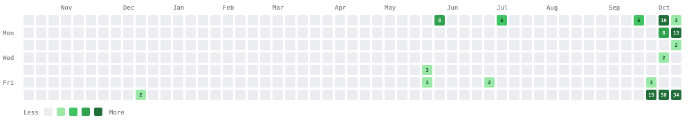

# Hi, I'm Deepak 👋

📍 **London** | 🚢 **Senior Solutions Architect at [Maersk](https://www.maersk.com)** | 🤖 **Integration platforms and agentic engineering**

I've spent 15 years building integration platforms and event-driven systems, first for M&S and now for Maersk's global procurement. Lately most of what I build is for working with coding agents: skills, hooks, verified context, and small apps that take the drag out of my day.

## Day Job

- 🏗️ **Re-architected Maersk's global procurement platform** for 600+ terminals. A small DSL and calculation engine replaced 3,120+ hardcoded branches, so business teams now configure 700+ material specs without waiting on engineers.
- 📉 Terminal onboarding is 80% faster, incidents are down 55-60%, and MTTR is down 74%.
- 🔐 Policy-as-code authorisation (OPA/Rego) across APIs, messaging, and data, plus a CQRS / event-sourced boundary between SAP and the services around it.
- 🧭 Technical direction for 3 squads (30 engineers) across the UK, Denmark, and India.
- 🤖 Running an AI-augmented delivery pipeline: Claude Code skills, hooks, and agent teams, with Codex as a second-opinion code reviewer.

## Building Now

Private for now; I'm opening these up one at a time.

- 📝 **quick-notes** - menu bar quick notes for macOS: paste, tag, find, copy (Swift)
- 🎯 **clarity** - verified golden-set context for multi-service products: cards, debates, a review app, and MCP tools
- 🎬 **explainer-studio** - narrated technical explainer videos made with Claude Code: local voice, word-synced scenes, QA gates
- 🧰 **claude-code** - my Claude Code and Claude Desktop skills and extensions
- 📚 **my-library** - a personal learning library of lessons, guides, and research reports that my agents file into
- 🏷️ **kindle-price** - compares a Kindle book's price on Amazon UK and Amazon India

## Before Maersk

At M&S (through TCS) I worked on the platform side for five years:

- ☁️ **BrightCloud** - Azure/Terraform orchestrator that cut new environment setup from a month to under an hour
- 🚪 **Muziris** - Backstage developer portal for service catalogue, API discovery, and one-click onboarding
- 🔑 **Ecosystem Builder** - self-service access management; onboarding went from 2 weeks to 10 minutes
- 🔌 **Enterprise Services** - ~20 microservices between SAP and modern consumers on Kafka and IBM MQ, which got M&S off the mainframe for those domains (~£6m a year saved)

## GitHub Activity

<!-- PROFILE-STATS:START -->
**1,175** contributions in the last year · busiest day **58** (10 Oct 2026) · current streak **2** days · longest streak **12** days
<!-- PROFILE-STATS:END -->

## Contributing To

- 📦 **[agents-in-a-box](https://github.com/stevengonsalvez/agents-in-a-box)** - context engineering for agentic coding
- 🧠 **[ainb-reflect-memory](https://github.com/stevengonsalvez/ainb-reflect-memory)** - long-term memory for AI coding agents

## How I Work

- **Build what's needed now.** No speculative flags or config.
- **Replace, don't deprecate.** Old code goes, no shims.
- **Test behaviour, not implementation.** Then break the code to prove the tests notice.
- **Fail fast and say how to fix it.** An error should name the operation, the input, and the next step.

## Connect

